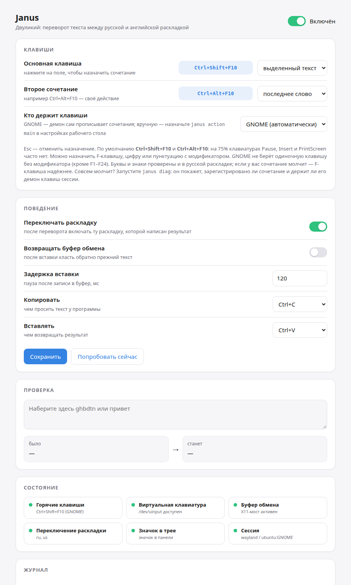

# Janus — переворот раскладки для Linux и Windows


> **Janus** (Янус) — римский бог входов, выходов и всякого перехода. Его изображали двуликим:
> одно лицо смотрит в прошлое, другое в будущее. У текста здесь тоже два лица — кириллица и
> латиница, и одна клавиша поворачивает его с одного на другое.

Облегчённый аналог [Punto Switcher](https://yandex.ru/soft/punto/win/): нажимаете клавишу — и текст,
набранный не в той раскладке, переворачивается между русской и английской. Своё сочетание
назначается нажатием в веб-интерфейсе, значок живёт в трее. Работает на **Linux (GNOME)** и на
**Windows**; на Linux проверено вживую, на Windows — собрано и ждёт первого запуска.

Написано на Go, без cgo и без внешних утилит: сборка — один бинарник (~9,7 МБ, почти всё —
сгенерированный код протокола X11 и D-Bus).

```
ghbdtn vjq ldeu   →   привет мой друг
привет мой друг   →   ghbdtn vjq ldeu
```



## Что умеет

* Переворот **выделенного текста** — как в Punto Switcher: выделили и нажали.
  Если ничего не выделено, берётся слово перед курсором.
* Переворот **последнего слова** отдельным сочетанием — на случай, когда выделять лень.
* Направление определяется само: кириллица → латиница, латиница → кириллица.
* После переворота включается та раскладка, которой написан результат, — чтобы дальше
  печатать уже правильно.
* Настройка в браузере: нажали на поле — нажали сочетание — готово. Сохраняется мгновенно.
* Значок в трее: открыть настройки, включить/выключить, выйти.
* Автозапуск при входе в систему.

## Горячие клавиши по умолчанию

| Сочетание | Что делает |
|---|---|
| **Ctrl+Shift+F10** | переворачивает выделенное, а если выделения нет — слово перед курсором |
| **Ctrl+Alt+F10** | переворачивает только последнее слово, не трогая выделение |

Почему F10, а не Pause, как в Punto: на 75% клавиатурах Pause, Insert и PrintScreen часто
отсутствуют, а GNOME не берёт глобальные сочетания без модификатора. F-клавиши есть почти
везде. Любое другое сочетание назначается в интерфейсе — нажмите на поле клавиши и нажмите
нужную комбинацию. Esc отменяет назначение.

Можно назначать F1–F24, буквы, цифры, стрелки, Home/End/PageUp/PageDown, Insert/Delete,
пунктуацию (`-`, `=`, `[`, `]`, `\`, `;`, `'`, `,`, `.`, `/`, `` ` ``) и клавиши цифрового
блока — с модификатором Ctrl/Alt/Shift/Super. Вживую проверено в GNOME (в том числе при
активной русской раскладке): `Ctrl+Shift+F10`, `Ctrl+Alt+\`, `Ctrl+Shift+\`, `Ctrl+Shift+J`.
Одиночные клавиши без модификатора GNOME обычно не берёт; исключение — F1–F24
(Pause/PrintScreen зависят от системы, на 75% их может не быть).

## Windows

Та же программа, без отдельного кода для пользователя: значок в области уведомлений, настройки в
браузере, те же сочетания и то же поведение. Собирается и на Windows, и кросс-компиляцией из Linux.

```powershell
# из Windows, в каталоге проекта
powershell -ExecutionPolicy Bypass -File scripts\install-windows.ps1
```

```bash
# из Linux: готовый dist/janus.exe
./scripts/build-windows.sh
```

Что делает установщик: собирает `janus.exe` с ключом `-H=windowsgui` в
`%LOCALAPPDATA%\Janus`, прописывает автозапуск в `HKCU\...\Run` и запускает демон.
Права администратора не нужны.

**Как устроено на Windows:**

| Задача | Чем решается |
|---|---|
| глобальная клавиша | `RegisterHotKey` в скрытом окне (его цикл сообщений — отдельный поток) |
| ввод | `SendInput`: текст как Unicode (раскладка не важна), Ctrl+C/V — виртуальными кодами |
| буфер обмена | `CF_UNICODETEXT` через `OpenClipboard` с окном-владельцем |
| раскладка | `GetKeyboardLayout` потока окна в фокусе + `WM_INPUTLANGCHANGEREQUEST`, с проверкой и фолбэками Win+Space / Ctrl+Shift |
| значок | `Shell_NotifyIcon`, иконка рисуется кодом в .ico, переживает перезапуск Explorer |
| IPC | порт 127.0.0.1 со случайным токеном в `ipc.port` |

**Статус: alpha.** Код компилируется под `windows/amd64`, проверен юнит-тестами движка и
разбором Win32-деталей министрами Polza.AI, но **на живой Windows ещё не запускался** — у меня её нет.
Поэтому в программу встроена команда отчёта:

```
janus diag
```

Она печатает: размер структуры `INPUT`, доступность `SendInput`, попытку регистрации каждого
сочетания с расшифровкой ошибки, круговой тест буфера (запись и чтение), список раскладок и активную,
права окна в фокусе (в окно с правами администратора ввод невозможен — это ограничение Windows, а не
программы). Если что-то не работает — пришлите вывод `janus diag` и %LOCALAPPDATA%\Janus\janus.log`.

**Чего на Windows ждать не надо:** автопереворота по мере набора (нужен низкоуровневый хук клавиатуры,
это отдельная и более навязчивая функция), работы в окнах, запущенных от администратора, и
сохранения картинок при включённом «возвращать буфер обмена».

## Установка

```bash
git clone https://github.com/petrovich811/janus-switcher
cd janus-switcher      # каталог проекта
./scripts/install.sh
```

Скрипт собирает бинарник в `~/.local/bin/janus`, прописывает горячие клавиши в GNOME,
добавляет автозапуск (`~/.config/autostart/janus.desktop`) и запускает демон.

Вручную то же самое:

```bash
go build -o ~/.local/bin/janus .    # нужен Go 1.26+
janus install                       # клавиши + автозапуск
janus daemon                        # запуск (или войти в сессию заново)
```

Настройки открываются по адресу http://127.0.0.1:8791/ или командой `janus ui`,
а также щелчком по значку в трее.

Если хочется держать демон под systemd, есть готовый юнит:

```bash
mkdir -p ~/.config/systemd/user
cp systemd/janus.service ~/.config/systemd/user/
systemctl --user daemon-reload
systemctl --user enable --now janus
```

Удалить: `./scripts/uninstall.sh` (настройки в `~/.config/janus/` остаются).

## Команды

```
janus daemon            демон: значок в трее и веб-настройки
janus action main|alt   выполнить переворот (эту команду зовут горячие клавиши)
janus convert ТЕКСТ     перевести текст из терминала
janus status            что включено, что работает, что нет
janus diag              диагностика для отчёта о проблеме
janus ui                открыть настройки в браузере
janus install           прописать клавиши и автозапуск
janus uninstall         убрать клавиши и автозапуск
janus extension         включить расширение значков в трее (GNOME)
```
## Как это работает

Три кирпича, каждый — обход ограничения Wayland:

1. **Горячая клавиша.** Wayland не даёт приложению перехватить клавиатуру глобально, зато GNOME
   сам умеет это делать: демон прописывает «пользовательское сочетание» в dconf, а его команда —
   `janus action main`. Никаких прав root, работает и в Wayland, и в X11. Меняете сочетание
   в браузере — демон переписывает запись в dconf.
2. **Нажатия в чужое окно.** Виртуальная клавиатура через `/dev/uinput`: события идут через ядро,
   поэтому их видит любое приложение, Wayland оно или X11. Так отправляются Ctrl+C, Ctrl+V и
   переключение раскладки.
3. **Буфер обмена.** Демон читает и пишет X11-выделение CLIPBOARD напрямую (протокол X11 на чистом Go).
   В GNOME на Wayland буфер продублирован между Wayland и X11, поэтому текст, скопированный
   в Wayland-приложении, читается, а вставленный демоном — вставляется в Wayland-приложение.

Порядок работы при нажатии клавиши:

```
нажатие → GNOME запускает janus action main
        → демон: Ctrl+C (или Ctrl+Shift+Left, если выделения нет)
        → читает буфер, переворачивает текст по таблице клавиш
        → кладёт результат в буфер, Ctrl+V
        → переключает раскладку на ту, которой написан результат
```

Про раскладку: ключ `current` в GNOME работает только на запись — shell его пишет, но не читает,
поэтому демон смотрит на `mru-sources` (первый в списке — активная раскладка) и нажимает ту самую
комбинацию переключения, которая настроена у вас в системе (по умолчанию Super+Space), пока
раскладка не станет нужной.

## Настройки

Файл `~/.config/janus/config.json` (правится и из веб-интерфейса):

| Поле | Смысл |
|---|---|
| `enabled` | перехват включён |
| `hotkey_main`, `hotkey_alt` | сочетания в виде GTK-акселераторов: F-клавиши, буквы, цифры, пунктуация, цифровой блок |
| `defaults_version` | служебное поле: передвигает старые Pause-умолчания на F10 при обновлении |
| `action_main`, `action_alt` | `selection` / `word` / `line` — что переворачивать |
| `switch_layout_after` | включать раскладку результата |
| `restore_clipboard` | возвращать прежний буфер обмена после вставки |
| `paste_delay_ms` | пауза перед Ctrl+V, если приложение медлительное |
| `release_delay_ms` | сколько ждать, пока отпустят клавиши сочетания (иначе Ctrl+C станет Ctrl+Shift+C) |
| `copy_shortcut`, `paste_shortcut` | чем просить и возвращать текст (в терминалах бывает нужно ctrl+shift+c) |
| `hotkey_source` | `gnome` — демон держит клавиши, `off` — назначаете сами |

Журнал работы: `~/.config/janus/janus.log`. Последние перевороты видны и в веб-интерфейсе.

Веб-интерфейс слушает только 127.0.0.1, а на изменения требует заголовок `X-Janus` — чтобы
страница в браузере не могла дёргать демон со стороны.
## Ограничения (честно)

* **Только GNOME** для автоматического назначения клавиш. В KDE, XFCE, Sway назначьте
  `janus action main` на любую клавишу средствами рабочего стола — остальное работает так же.
* **Нужен модификатор.** Одиночные клавиши без модификатора GNOME не берёт (кроме F1–F24).
  На 75% клавиатурах может не быть Pause, Insert и PrintScreen — по умолчанию используются
  F10-сочетания, а остальное назначается в интерфейсе. Ctrl+Shift+F9…F12 иногда перехватывают
  браузеры или IDE — если клавиша молчит, назначьте другую.
* **Буквы и пунктуация на Linux.** В проверенной GNOME-сессии `Ctrl+Shift+J`,
  `Ctrl+Shift+\` и `Ctrl+Alt+\` срабатывали и при русской раскладке. Если в вашей системе
  сочетание молчит, назначьте F-клавишу — она не зависит от раскладки.
* **Нет автопереворота при наборе.** Punto Switcher следит за набором и сам переворачивает слово
  по пробелу; здесь переворот только по клавише — для этого пришлось бы читать `/dev/input`,
  а это требует прав на устройства ввода.
* **Работает через буфер обмена**, поэтому: текст только plain, картинки и форматирование при
  `restore_clipboard` не восстанавливаются; приложения, которые не отдают выделение по Ctrl+C
  (некоторые терминалы, отдельные Electron-программы), нужно переключить на ctrl+shift+c /
  shift+insert в настройках.
* **Ctrl+C / Ctrl+V под русской раскладкой.** Клавиши посылаются физическими кодами; большинство
  приложений понимает их и в русской раскладке, но некоторые — нет. Если не срабатывает,
  переключите сочетания копирования и вставки на ctrl+insert / shift+insert.
* **X11-мост.** Чтение буфера опирается на то, что GNOME дублирует буфер обмена в X11.
  Без Xwayland (например, в чистом Sway) буфер работать не будет.
* **Права на `/dev/uinput`.** Обычно они уже есть у активной сессии. Если вдруг нет — добавьте
  пользователя в группу `input` и правило udev, затем перезайдите.
* **Windows: только amd64.** Сборка под 386 не поддерживается; трюки с Win32-структурами
  рассчитаны на 64-битный указатель.
* **Windows: не-текстовый буфер не восстанавливается.** Диагностика `janus diag` не трогает
  буфер, если в нём нет текста, но картинку или файл вернуть после переворота нельзя.
* **Задержка восстановления буфера — 700 мс.** Медленное приложение может прочитать буфер
  уже после того, как туда вернулся старый текст; это ограничение эвристики, а не сбой.
* **Восстановление буфера не атомарно.** Если другая программа запишет свой текст между
  проверкой и возвратом старого, её текст может быть заменён. Если исходный буфер не
  читается (нет текста, занят, нет X11), вернуть его нечем — Janus хотя бы убирает свою пробу.
* **X11: медленный владелец буфера.** Если приложение не ответило на запрос за 1,5 с, чтение
  возвращает пустой результат; запоздавший ответ отбрасывается по номеру свойства.

## Что уже есть на GitHub и вокруг

Прежде чем писать, посмотрел, что существует:

* **[easy-switcher](https://github.com/freemind001/easy-switcher)** — самый близкий аналог: демон на
  Pascal, читает клавиатуру прямо через ядро, Pause переворачивает последнее слово, Shift+Pause —
  всю фразу. Работает в любом окружении, но требует root/systemd и прав на устройства ввода;
  настраивается через терминал, без трея и веб-интерфейса. Оттуда же взята идея
  «Shift + клавиша переворота».
* **[xneur](https://help.ubuntu.ru/wiki/xneur) / gxneur** — старый автокорректор раскладки со словарём:
  сам переворачивает слова по мере набора, есть трей и GTK-настройки. Ограничен X11, развивается
  вяло, словарь и правила тяжеловаты.
* **Caramba Switcher** — платный, Windows/macOS; **Punto Switcher** — Windows, закрытый.
* Ещё попадались обёртки над xneur и one-key switcher для Windows — ничего под Wayland с
  веб-настройками и треем на Go не нашлось, поэтому этот проект и появился.

Отличие от них: без root, без словаря, без автокоррекции — маленький демон, который делает одну
вещь (переворот по клавише), живёт в трее и настраивается в браузере.

## Устройство

```
main.go                    команды, демон, применение настроек, статус
internal/convert           таблицы раскладок йцукен/qwerty, определение направления
internal/inject            ввод: uinput на Linux, SendInput на Windows
internal/clipboard         буфер: X11 на чистом Go (с INCR) и user32 на Windows
internal/hotkey            GTK-акселераторы, записи GNOME в dconf
internal/layout            раскладки: mru-sources в GNOME и HKL в Windows
internal/tray              значок Linux: StatusNotifierItem, меню DBus; .ico для Windows
internal/server            HTTP API и встроенная страница настроек
internal/engine            сам переворот: взять текст, конвертировать, вставить
internal/winhost           Windows: скрытое окно, RegisterHotKey, значок, меню
platform_linux.go          Linux-обвязка: GNOME-сочетания, D-Bus-трей, автозапуск
platform_windows.go        Windows-обвязка: хоткеи, автозапуск в реестре, diag
scripts/, systemd/         установка (Linux, Windows) и юнит для systemd
```

Зависимости: `github.com/jezek/xgb` (X11), `github.com/godbus/dbus/v5` (трей Linux),
`golang.org/x/sys` (ioctl и Win32). Всё остальное — стандартная библиотека. Обе платформы
собираются с `CGO_ENABLED=0`: ни компилятора C, ни GTK на машине не нужно.

## Что проверено, а что нет

| Что | Как проверено |
|---|---|
| переворот по горячей клавише (Linux) | вживую: нажатие подавалось через /dev/uinput, текст переворачивался в обе стороны, раскладка переключалась |
| движок: копирование, проба, вставка, восстановление буфера | юнит-тесты с поддельными клавиатурой и буфером (`go test ./...`) |
| таблицы раскладок | юнит-тесты: 13 пар, круговая обратимость, полнота таблиц |
| значок в трее (Linux) | вживую: StatusNotifierItem зарегистрирован, меню и иконка отдаются по D-Bus |
| генератор .ico для Windows | юнит-тест: заголовки, выравнивание, размер маски |
| Windows целиком | компиляция `GOOS=windows`, `go vet`, юнит-тесты и разбор министрами Polza.AI; **запуска на живой Windows не было** |
| CI | Linux и Windows: сборка, тесты, `go vet`; Linux дополнительно `-race` |

## Документация для сопровождения

* [AI_CONTEXT.md](AI_CONTEXT.md) — контекст для AI-агентов: архитектура, инварианты,
  проверки, известные ограничения.
* [DECISIONS.md](DECISIONS.md) — журнал архитектурных решений: что выбрано, почему и какие
  альтернативы отклонены.
* [AGENTS.md](AGENTS.md) — короткая памятка для агентов перед изменением кода.

## Лицензия

MIT. Проект не связан с «Яндексом» и Punto Switcher — это самостоятельная реализация той же идеи
для Linux и Windows.

## Разработка

```bash
go build -o /tmp/janus .                       # сборка под текущую систему
GOOS=windows go build -o dist/janus.exe .      # кросс-сборка под Windows
go test ./...                                  # юнит-тесты
go test -race ./...                            # гонки (Linux)
go vet ./...                                   # проверка
GOOS=windows go vet ./...                      # проверка Windows-кода
/tmp/janus convert ghbdtn                      # быстрая проверка таблиц
/tmp/janus diag                                # отчёт о состоянии
JANUS_CONFIG_DIR=/tmp/pcfg /tmp/janus daemon   # отдельный конфиг для экспериментов
```

Таблицы переводов лежат в `internal/convert/keymap.go`: одна таблица на раскладку, из неё
выводятся обе стороны (символ → клавиша и клавиша → символ), поэтому переворот всегда идёт
по физическим клавишам, а не по буквам.
